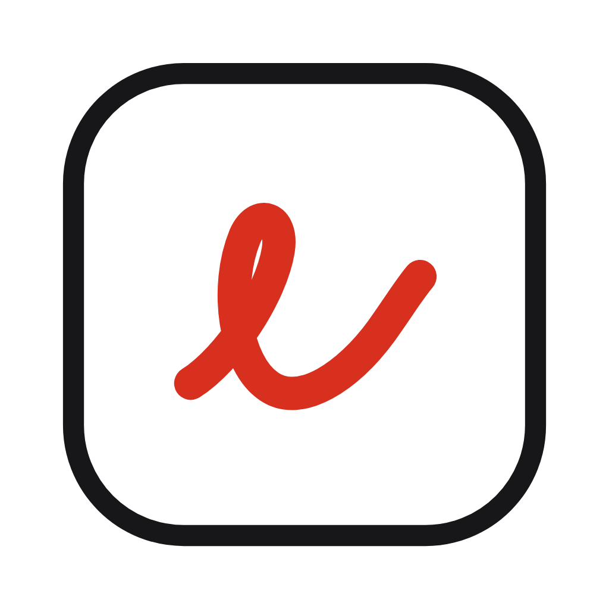
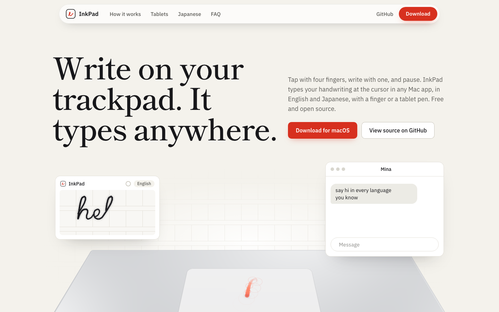
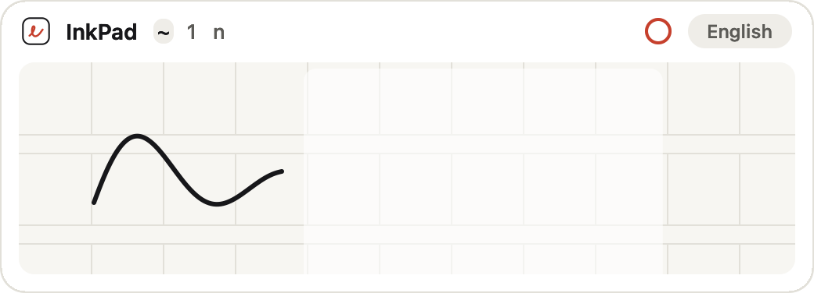
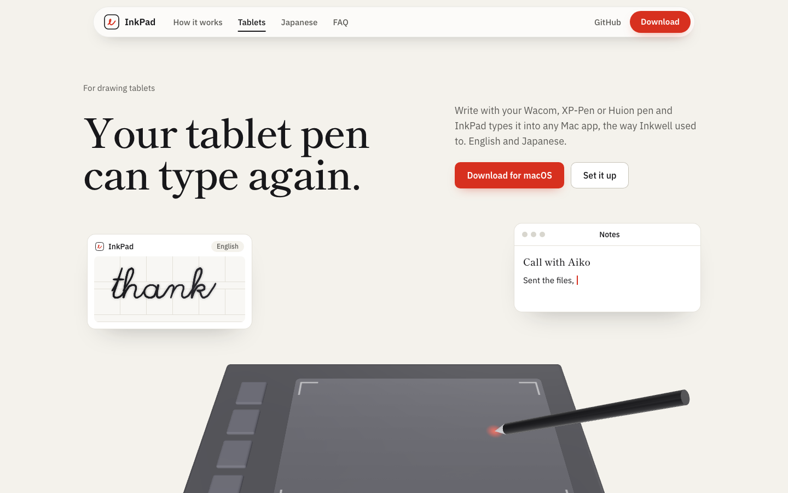
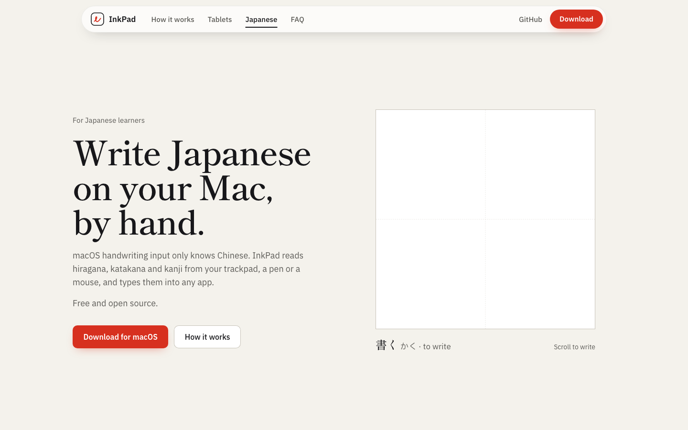

<p align="center">
  
</p>

<h1 align="center">InkPad</h1>

<p align="center">
  <b>Write on your Mac's trackpad. It types anywhere.</b><br>
  Handwriting input for macOS: use a finger or a tablet pen, and InkPad types what you wrote at the cursor in any app.
</p>

<p align="center">
  <a href="https://github.com/NOOB-3301/inkpad/actions/workflows/ci.yml"></a>
  <a href="https://github.com/NOOB-3301/inkpad/releases/latest"></a>
  
  
  
  
</p>

<p align="center">
  
</p>

---

## What it is

macOS has no handwriting input for English, and none for Japanese on a Mac. **InkPad** is a small menu-bar app that adds one:

1. **Tap with four fingers.** A floating pad opens next to your cursor, in whatever app you're using.
2. **Write with one finger** (or a pen). The whole trackpad is your writing surface.
3. **Pause.** InkPad reads your writing and types it where your cursor was.

No window switching, no special text field. It works in Messages, Notes, a browser, a terminal, a dictionary search box, anywhere you can type.

<p align="center">
  
</p>

## Features

- **Write with a finger.** Raw multitouch from the trackpad, so the pad is the entire trackpad surface, not the small cursor-driven area.
- **Write with a pen.** Wacom, XP-Pen, Huion and other drawing tablets work as an absolute-position surface.
- **English and Japanese.** Hiragana, katakana and kanji. Pick one, or Auto for both.
- **Gboard-grade accuracy.** Strokes go to Google's handwriting recognizer by default. Switch to offline and Apple's Vision framework reads your writing on the Mac, with a small accuracy drop.
- **Touch gestures** to edit without the keyboard (see below).
- **Haptic ticks.** The trackpad ticks every few millimetres as your finger glides, and a little firmer on insert and delete. Off, Light or Strong.
- **Wait ring.** The red ring in the header refills during the pause, so you see exactly when text will go in.
- **Cursor lock.** While a finger is down on the open pad, trackpad pointer movement, clicks and scrolling are blocked, so the cursor doesn't wander while you write. Mouse and pen are unaffected.
- **Pick mode.** Prefer to choose? Switch from auto-insert to "Pick from candidates".
- **Conveyor.** The writing window advances as you write, so you can write a whole sentence on one pad.

## Gestures

| Gesture | What it does |
|---|---|
| 4-finger tap (or 5, in the menu) | Open or close the pad |
| 1 finger | Write |
| 2-finger swipe **←** | Delete |
| 2-finger swipe **→** | Insert a space |
| 2-finger tap | Insert now, without waiting |
| 3-finger tap | Next candidate (pick mode) |
| **⌃⌥Space** | Open or close the pad (rebindable) |
| **Esc** / **Return** | Cancel / insert now, while the pad is open |

## Install

**Download.** Grab the latest `InkPad-x.y.z.dmg` from [Releases](https://github.com/NOOB-3301/inkpad/releases/latest), open it and drag InkPad.app to Applications. Each release is built by GitHub Actions from the public source and carries a build attestation: `gh attestation verify InkPad-*.dmg --repo NOOB-3301/inkpad`.

**Or build it yourself** in a minute:

```sh
git clone https://github.com/NOOB-3301/inkpad.git
cd inkpad
scripts/bundle.sh          # builds build/InkPad.app (menu-bar app, ad-hoc signed)
open build/InkPad.app
```

Requires macOS 15 or later and the Swift 6 toolchain (Xcode or Command Line Tools).

**First launch**

1. macOS blocks unsigned apps. Open System Settings → Privacy & Security → **Open Anyway**, or run:
   ```sh
   xattr -dr com.apple.quarantine build/InkPad.app
   ```
2. Allow **Accessibility** access when asked. macOS requires it for any app that types into other apps, and InkPad needs it for the cursor lock as well.
3. Click the InkPad logo in the menu bar to set language, wait time, haptics and more.

> **Heads up:** every rebuild with an ad-hoc signature resets the Accessibility permission. Re-grant it in System Settings after each build, or sign with a stable certificate.

## Menu bar settings

| Item | Options |
|---|---|
| Open / Close Pad | ⌃⌥Space by default, "Set Hotkey…" to change |
| Open/close gesture | 4-finger tap (default) or 5-finger tap |
| Language | English, Japanese, Auto |
| Wait before inserting | 0.6, 1.0 (default), 1.5, 2.0, 3.0 seconds |
| Online recognition (Google) | On by default. Off = Apple Vision, entirely on-device |
| Insert mode | Auto-insert after pause, or Pick from candidates |
| Haptic feedback | Off, Light (default), Strong |

## Privacy

Be clear about what leaves your Mac:

- **Online recognition is on by default.** Only your **pen strokes** (coordinates and timing) are sent to Google's handwriting recognition endpoint, the engine behind Gboard handwriting. Never your screen, your keystrokes or existing text. It is an **unofficial** endpoint and could change or stop working; when it fails, InkPad falls back to Apple Vision automatically.
- **Turn it off** in the menu and everything is read on your Mac with Apple's Vision framework. No network requests.
- No account, no analytics, no telemetry.

## For drawing-tablet users

Inkwell, the handwriting input built into macOS until Catalina, was dropped from macOS and never came to iPad-style tablets on Mac. If you own a Wacom, XP-Pen or Huion tablet, InkPad types with your pen the same way. Tablet drivers deliver absolute mouse events, which the pad reads as a pen.

<p align="center">
  
  
</p>

## How it works

```
trackpad ──► MultitouchSupport (raw touches) ──► GestureDetector ──┐
pen / mouse ──► NSEvent (absolute mouse events) ───────────────────┤
                                                                   ▼
                  PadController: strokes → OneEuro smoothing → Conveyor
                                                                   │ pause
                                                                   ▼
        Recognizer ── online ──► Google Input Tools ──┐
                   └─ offline ─► Vision (Rasterizer)  ├─► candidates
                                                      ▼
                         Inserter: pasteboard / key events ──► the app under your cursor
```

| Module | Role |
|---|---|
| `InkPadCore` | Pure logic with no UI: `Stroke`, `GestureDetector`, `Recognizer`, `Rasterizer`, `Spacing`. Unit-tested. |
| `InkPad` | The menu-bar app: `PadController`, `InkView`, `TouchSource`, `CursorGate`, `HotKey`, `Inserter`, `Settings`. |

**A note on private API.** Reading raw trackpad touches uses Apple's private `MultitouchSupport.framework`, because no public API delivers global multitouch data. It works on current macOS, but Apple can change it, and an app that uses it can't be distributed through the Mac App Store.

## Develop

```sh
swift build                 # debug build
scripts/test.sh             # runs the 16 unit tests (works with Command Line Tools only)
scripts/bundle.sh           # release .app bundle in build/ (VERSION=1.2.3 scripts/bundle.sh to set the version)
scripts/dmg.sh              # packs build/InkPad.app into InkPad-<version>.dmg
```

**Releasing.** Push a tag and GitHub Actions tests, builds, packs a .dmg, attests and publishes it:

```sh
git tag v0.1.0 && git push origin v0.1.0
```

CI (`.github/workflows/ci.yml`) builds and runs the tests on every push and pull request.

`scripts/test.sh` wires up swift-testing for Command Line Tools installs that don't ship it in SwiftPM; with full Xcode it just runs `swift test`.

```
Sources/InkPadCore/   recognition, gestures, strokes (tested)
Sources/InkPad/       menu-bar app and UI
Tests/                unit tests
Resources/            app icon (SVG source and .icns)
.github/workflows/    CI and tag-triggered release
docs/                 screenshots used in this README
scripts/              bundle, dmg and test helpers
```

## The website

The marketing site (Next.js, GSAP, three.js) lives in a separate repo: [**inkpad-site**](https://github.com/NOOB-3301/inkpad-site).

## Roadmap

- [x] Automated build and release from tags (ad-hoc signed)
- [ ] Signed, notarized release so Gatekeeper and Accessibility stop getting in the way
- [ ] Korean (the engine is ready; Hangul handwriting needs more testing)
- [ ] Chinese
- [ ] Stable signing identity so the Accessibility grant survives updates
- [ ] Dark appearance for the pad

## License

[GPL-3.0](LICENSE). Free to use, study, change and share.
